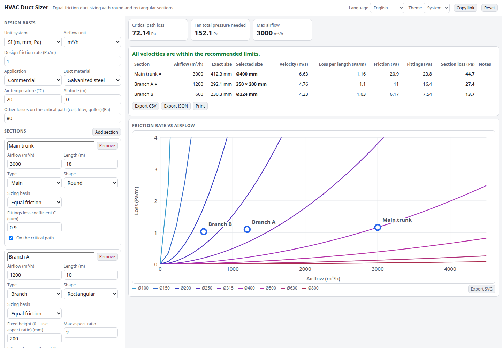

# HVAC Duct Sizer

Size ducts with the equal-friction method. Enter the airflow and length of each duct section, choose a design friction rate (or a target velocity), and get round or rectangular sizes rounded to standard sizes, the air velocity, the pressure loss per length and the total loss on the critical path, which tells you the fan pressure you need.

**Try it: [hermes98761234.github.io/hvac-duct-sizer](https://hermes98761234.github.io/hvac-duct-sizer/)**

[](https://github.com/hermes98761234/hvac-duct-sizer/actions/workflows/deploy.yml)



## Features

- **Equal-friction sizing** for round ducts at a design rate in Pa/m or in.wg/100 ft, or sizing by **target velocity**.
- **Rectangular ducts** from a fixed height or a maximum aspect ratio, using the **Huebscher equivalent diameter** (De = 1.30 (ab)^0.625 / (a+b)^0.25). A converter turns rectangular sizes into round ones and back.
- Velocity, pressure loss per length, friction and fitting losses (C coefficients) per section, with velocity limits for residential, commercial and industrial use.
- Critical path total plus coil, filter and grille losses, which gives the fan total pressure.
- Air density from temperature and altitude, seven duct materials, a friction chart with your sections plotted on it.
- Airflow in m³/h, L/s, m³/s or cfm; SI or imperial dimensions. CSV, JSON and SVG export, print, share link, English and Ukrainian, light and dark. Everything runs in the browser.

## How it works

Friction uses Darcy-Weisbach, Δp/L = f/D · ρv²/2, with the Colebrook friction factor and ρ from the ideal gas law. The round diameter for a design rate is found by bisection. A rectangular duct carrying the same flow with the Huebscher equivalent diameter has the same friction. The selected standard size is then re-checked, so the velocity and loss shown are for the size you would actually buy. Fitting losses are C·ρv²/2.

This is a design aid: confirm results against your local standards (SMACNA, ASHRAE, CIBSE).

## Quick start

You need [Node.js](https://nodejs.org/) 22.

```bash
git clone https://github.com/hermes98761234/hvac-duct-sizer.git
cd hvac-duct-sizer
npm install
npm run dev       # http://localhost:5173
npm test          # unit tests
npm run build     # static site in dist/
```

## License

MIT
